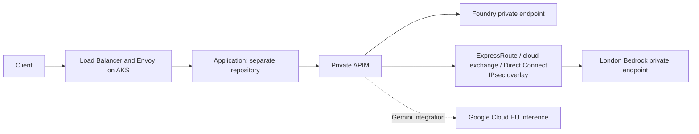

# ADR 0001: Regulated model access with Foundry, Bedrock and APIM

- Status: Proposed
- Date and provider evidence checked: 2026-10-11
- Issue: [AI-30](https://linear.app/ai-platform-portfolio/issue/AI-30/draft-adr-for-model-gateway-architecture)

## Context

Design a model-access platform for regulated financial services environments: confidential financial data, controlled processing locations, least-privilege access, auditable changes and attributable consumption. Azure is the primary platform cloud. Deploy infrastructure in the UK initially; parameterize Terraform modules for additional regions and residency policies. Applications and evaluations are maintained in a separate repository.

## Decision

Implement Microsoft Foundry for GPT, Amazon Bedrock for Claude and approved open models, and Azure API Management (APIM) for inference access and governance. Deploy self-hosted Envoy Gateway on AKS in-lieu of Azure Application Gateway for cost effectiveness: the required TLS termination and HTTP routing functionality is provided by open-source software without a gateway licence or Application Gateway service charge. AKS compute and Azure Load Balancer remain chargeable. [Envoy Gateway](https://github.com/envoyproxy/gateway).

### Why Foundry and Bedrock

| Requirement | Selected service and specific reason |
| --- | --- |
| GPT within the Azure platform | Foundry provides managed GPT deployments, Entra authentication and Private Link. Bedrock's GPT-6.1 Sol currently offers US/global inference, without a UK/EU route; it cannot replace Foundry for this requirement. [AWS GPT model card](https://docs.aws.amazon.com/bedrock/latest/userguide/model-card-openai-gpt-6-1-sol.html). |
| Claude with UK/EU processing | Foundry Claude documents Global Standard and selected US Data Zone deployments, without an EU Data Zone option. Bedrock Sonnet 5.5 provides `eu.anthropic.claude-sonnet-5-5` from London, routing to the UK and EU member states. This is the concrete reason for adding Bedrock. [Foundry Claude](https://learn.microsoft.com/en-us/azure/foundry/foundry-models/how-to/use-foundry-models-claude), [Bedrock Sonnet profile](https://docs.aws.amazon.com/bedrock/latest/userguide/model-card-anthropic-claude-sonnet-5-5.html). |
| Open models and independent provider capacity | Register approved Bedrock open-model endpoints alongside Claude through the same AWS networking and IAM infrastructure. |

Model onboarding uses a versioned backend configuration containing the deployment/profile, API, processing scope and retention approval. Enable only UK/EU-approved inference routes in the UK environment; deny global deployments/profiles through deployment and runtime policies. GPT uses an approved geography-scoped Foundry deployment. EU Data Zone scope follows Microsoft's broader EU Data Boundary and is not the default for the strict UK/EU allowlist. [Foundry deployment types](https://learn.microsoft.com/en-us/azure/foundry/foundry-models/concepts/deployment-types).

Direct Anthropic is not selected because its documented inference locations are US/global. Direct OpenAI's European scope includes EEA and Switzerland, exceeding the selected UK/EU boundary. [Anthropic residency](https://platform.claude.com/docs/en/manage-claude/data-residency), [OpenAI residency](https://developers.openai.com/api/docs/guides/your-data).

Gemini requires a Google Cloud project and an approved Google Cloud EU inference endpoint behind APIM. Its model-specific residency table supports Gemini 3.8 Flash in the EU multi-region. This is the additional Gemini integration; the Gemini Developer API is not selected for residency-constrained traffic. [Google model residency](https://docs.cloud.google.com/gemini-enterprise-agent-platform/resources/data-residency), [Google endpoints](https://docs.cloud.google.com/gemini-enterprise-agent-platform/resources/locations).

Model-specific retention approvals include Bedrock's Fable review-retention requirements. The selected providers expose regional model access through cloud IAM, private networking and auditable billing; these controls fit the financial-services platform operating model. [Bedrock retention](https://docs.aws.amazon.com/bedrock/latest/userguide/abuse-detection.html).

### Deployment

| Component | UK implementation |
| --- | --- |
| Kubernetes ingress | AKS in UK South; Envoy Gateway and Azure Load Balancer |
| Model access | APIM Standard v2 in UK West, inbound Private Link and outbound VNet integration |
| Azure inference | Foundry in UK South, private endpoint and approved GPT deployment |
| AWS inference | VPC in `eu-west-2`, Bedrock Runtime and STS interface endpoints, private DNS and endpoint policies |
| Cross-cloud transport | ExpressRoute and Direct Connect through a UK cloud exchange, with IPsec overlay |
| Platform controls | Entra identities/RBAC, AWS IAM, Key Vault, private DNS, regional diagnostics and billing budgets |

APIM is placed in UK West because Microsoft's current availability table marks new v2 instances in UK South temporarily unavailable. Peer its UK West VNet with the UK South platform VNet. [APIM regional availability](https://learn.microsoft.com/en-us/azure/api-management/api-management-region-availability).

Terraform inputs specify regions, CIDRs, circuit references, endpoint/model approvals, quotas and diagnostics. Separate environment state and backend allowlists support later regional deployments without cross-boundary failover.

### APIM and Envoy responsibilities

APIM validates Entra workload tokens, authorizes tenant access and routes configured aliases/task categories to approved backends. Policies provide request limits, supported token quotas, backend priorities, circuit breakers and bounded retries. Retain provider-native API routes: Foundry OpenAI APIs and Bedrock Runtime InvokeModel/Converse. Streaming routes disable response buffering; fallback is configured only between compatible backends before response output starts. [APIM capabilities](https://learn.microsoft.com/en-us/azure/api-management/genai-gateway-capabilities), [backend pools](https://learn.microsoft.com/en-us/azure/api-management/backends).

The unified model API is optional and excluded from the initial implementation. Microsoft's dedicated documentation explicitly labels it preview and lists OpenAI Chat Completions/Anthropic Messages translation. Established APIM AI policies are used independently of that feature. [Unified model API status](https://learn.microsoft.com/en-us/azure/api-management/unified-model-api).

Envoy owns application TLS, HTTP routing and ingress traffic controls. Applications call private APIM directly for inference. Deploy pinned Envoy versions with multiple data-plane replicas. Public-ingress WAF is a separate security control; the current ingress scope is TLS and HTTP routing.

### Cross-cloud transport

Select redundant ExpressRoute/Direct Connect connections through a UK cloud exchange such as Megaport or Equinix. Run an IPsec overlay between network appliances in the two clouds and retain HTTPS to Bedrock. This combines a private underlay with encryption across the exchange. Route inference traffic only through the encrypted overlay; restrict AWS endpoint security groups to the authorized source path. Provision circuits through the exchange and reference their identifiers in Terraform. [Microsoft connectivity options](https://learn.microsoft.com/en-us/azure/cloud-adoption-framework/ready/azure-best-practices/connectivity-to-other-providers), [private-path encryption](https://learn.microsoft.com/en-us/azure/networking/design-guide/cross-region).

| Alternative | Decision |
| --- | --- |
| Internet site-to-site IPsec VPN | Lower circuit cost and encrypted transport, but does not meet the selected private-underlay requirement |
| ExpressRoute/Direct Connect with TLS alone | Private transport, but the selected design also requires network-layer encryption across the exchange |
| Azure Multicloud Interconnect / AWS Interconnect | Managed private links with MACsec; currently preview, without an Azure preview SLA or UK region in the published availability list |
| SD-WAN/NVA tunnels over internet | Adds appliance operation without removing public-internet transport |

The managed interconnect is a real alternative, not a VPN-only limitation. Its published preview locations exclude the UK. [Interconnect security](https://learn.microsoft.com/en-us/azure/multicloud-interconnect/overview), [availability and SLA](https://learn.microsoft.com/en-us/azure/multicloud-interconnect/availability-limits).

### Identity

APIM uses a user-assigned managed identity and scoped Foundry RBAC. For Bedrock, implement Entra-to-AWS federation in APIM policy fragments:

1. Obtain an Entra token for a dedicated federation application using APIM managed identity.
2. Exchange it at regional AWS STS using `AssumeRoleWithWebIdentity`; IAM trust restricts issuer, audience and subject to that identity.
3. Sign Bedrock Runtime requests with SigV4 using the returned temporary credentials, including the session token. Cache credentials only until before expiration.

This composes documented APIM token acquisition, AWS Entra federation and APIM request-signing mechanisms; it is a policy implementation, not a built-in federation connector. Scope the role to approved model/profile resources and restrict policy editing to the platform deployment identity. [APIM identity policy](https://learn.microsoft.com/en-us/azure/api-management/authentication-managed-identity-policy), [AWS Entra federation](https://aws.amazon.com/blogs/apn/automating-openid-connect-based-aws-iam-web-identity-roles-with-microsoft-entra-id/), [APIM Bedrock signing](https://learn.microsoft.com/en-us/azure/api-management/amazon-bedrock-passthrough-llm-api).

### Cost, tokens and audit

- Apply per-tenant/workload request limits, output-token caps and daily/monthly token allowances. Use `llm-token-limit` on supported API schemas; native Bedrock routes use request/output caps and provider quotas, with usage reporting from their native responses. Streaming estimates and concurrent overshoot preclude treating APIM quotas as an exact global spend ledger. [Token policy](https://learn.microsoft.com/en-us/azure/api-management/llm-token-limit-policy).
- Emit model, provider, workload, latency, errors and token usage to regional monitoring. Disable prompt/response logging and shared content caching. Use token metrics where the schema supports them. [Token metrics](https://learn.microsoft.com/en-us/azure/api-management/llm-emit-token-metric-policy).
- Tag resources and reconcile estimated inference spend with Azure/AWS billing exports. Configure monthly budgets, forecast notifications and anomaly alerts. Report platform spend separately: APIM, AKS/Load Balancer, exchange/circuits, IPsec appliances, endpoints, transfer and telemetry. Budgets notify; gateway quotas enforce consumption limits.

## Validation

Validate IaC and gateway policies; test private DNS/transport, STS renewal, denied identities/routes, native streaming, throttling, token reporting and circuit/tunnel failure using synthetic requests. Confirm billing allocation and content-free audit records. Application behavior and model evaluations are tested in their own repository.

## Related decisions

[Azure Front Door incident](../research/azure-front-door-outage.md) informs ingress failure testing. [AWS recovery scope](../design/aws-failover.md) records the separate infrastructure recovery work.
