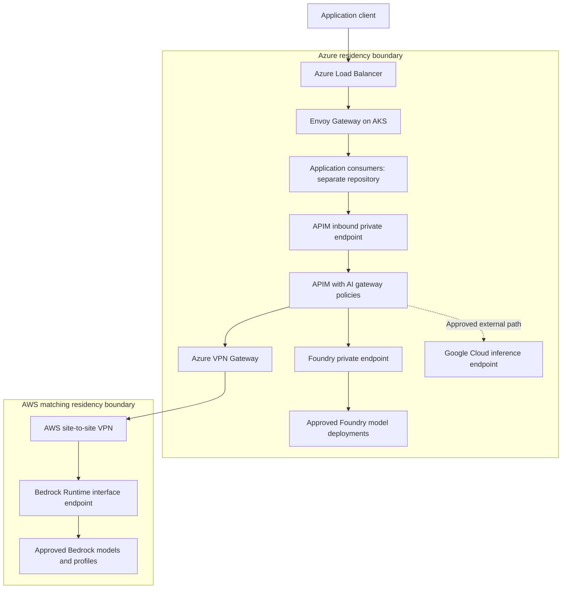

# ADR 0001: Foundry and Bedrock infrastructure with APIM and Envoy Gateway

- Status: Proposed; infrastructure choices agreed, implementation gates outstanding
- Date: 2026-10-11
- Issue: [AI-30](https://linear.app/ai-platform-portfolio/issue/AI-30/draft-adr-for-model-gateway-architecture)
- Scope: Infrastructure, provider access, networking, identity, ingress and gateway governance

## Context and scope

Azure is the primary platform cloud. The infrastructure must expose governed access to GPT, Claude, Gemini and approved open models while maintaining separate US and UK/EU processing boundaries. Model releases, features, account access and processing locations differ across providers. A catalogue listing or a private endpoint does not establish residency or availability.

This repository owns Terraform infrastructure and Kubernetes platform configuration, including gateway policies, backend definitions, identity, DNS, network controls and infrastructure observability. Applications, agent workers, prompts, tools, datasets, evaluations and automatic model judgement belong in a separate repository. This ADR does not select application frameworks, databases, queues or workflow implementations. No custom FastAPI inference proxy or model-selection service is required.

## Decision

Use Microsoft Foundry and Amazon Bedrock as complementary managed inference services. Use Azure API Management (APIM), including its AI gateway capabilities, as the internal model access and governance layer. Use self-hosted Envoy Gateway on AKS for application ingress instead of Azure Application Gateway.

AI gateway capabilities are features of APIM; they do not require a second inference gateway in series. Start from APIM Standard v2 with an inbound private endpoint and outbound VNet integration. Confirm regional availability, capacity, resilience and feature requirements before implementation; use Premium v2 if those requirements justify it. The separate AI Gateway preview tier is not a baseline dependency.

### Why Foundry and Bedrock

| Service | Role and reason for selection | Limit |
| --- | --- | --- |
| Microsoft Foundry | Azure-native managed model deployments, particularly GPT; integrates with Azure identity, private endpoints and platform governance | Model/version/deployment-type availability varies; global processing is unsuitable for restricted tenants |
| Amazon Bedrock | Complementary Claude and open-model catalogue, approved geographic inference profiles, and an independent inference service | Region, source endpoint, profile destinations, entitlement, retention and features require individual checks |

Neither platform is universally first to serve every latest model in every approved geography. Foundry supplies the primary Azure model path; Bedrock supplies additional model and geography options. The combination reduces dependence on one catalogue and one cloud's release schedule. It does not guarantee day-one compliant access, zero retention, API parity or equivalent replacement models.

The earlier research identifies useful GPT routes in Foundry and Claude routes in Bedrock, but production approval remains specific to each exact model version and endpoint. A residency-constrained new model may remain unavailable even when a global offering exists.

Gemini is an additional external Google Cloud inference path behind APIM, using a Google Cloud project, billing and approved regional or multi-regional API. Foundry plus Bedrock does not eliminate that account relationship. No Google managed agent runtime is required. Initial implementation focuses on Foundry and Bedrock; Google access is a subsequent infrastructure integration with its own authentication, transport and residency gates. Direct frontier-lab APIs and private GPU serving are outside the initial deployment.

### Deployment shape

Repeat this logical topology independently for the US and UK/EU boundaries. Application boxes represent consumers deployed from the separate repository.

Internal inference calls go directly from applications to APIM; they do not need to traverse Envoy. Foundry and Bedrock are alternative backends, not a chain. Application Gateway is not deployed. Front Door is not required by this decision; adding a global edge later requires an independent ingress recovery design informed by [the Front Door incident note](../research/azure-front-door-outage.md).

### APIM and AI gateway responsibilities

APIM owns configured routing and API governance:

- Validate workload tokens and authorize access using trusted tenant/workspace identity. Never accept caller-supplied residency as authoritative.
- Route model aliases or application-declared task categories to approved backends using versioned policies. The separate application/evaluation repository supplies reviewed routing requirements; APIM does not judge prompt complexity or model quality automatically.
- Keep US and UK/EU backend allowlists separate. Reject unknown models, unauthorized overrides and routes outside the tenant's approved boundary.
- Authenticate to Foundry with managed identity and scoped RBAC where supported. Configure and validate provider-specific credentials for AWS and Google independently.
- Apply request limits, token limits for supported API schemas, backend pools, priorities, weights and circuit breakers. Token limits are consumption controls, not an exact financial budget ledger.
- Emit operational metrics and audit metadata without routine prompt, response, reasoning or credential logging. Content-bearing caches are disabled initially.
- Permit fallback only among explicitly approved, API-compatible endpoints. Refusals do not trigger safety-bypassing fallback; partial streams are not transparently restarted on another model.

[APIM AI capabilities](https://learn.microsoft.com/en-us/azure/api-management/genai-gateway-capabilities), [backend pools](https://learn.microsoft.com/en-us/azure/api-management/backends) and [token limits](https://learn.microsoft.com/en-us/azure/api-management/llm-token-limit-policy) document these facilities and tier/schema limitations.

The [unified model API](https://learn.microsoft.com/en-us/azure/api-management/unified-model-api) remains preview. Its documented translation scope covers OpenAI Chat Completions and Anthropic Messages backend formats. It is an optional integration, not proof that native Bedrock Converse/InvokeModel, Google APIs, Responses or every provider feature can be exchanged transparently. Preserve provider-native API routes when needed. Backend pooling alone does not translate incompatible protocols; cross-provider fallback requires validated request/response compatibility.

### Cost and token management

Manage inference consumption through APIM policies and provider budgets. Key limits by authenticated tenant/workload and model route, with distinct counter keys where quotas differ. Configure request-rate limits, token-per-minute limits and daily/monthly token quotas for supported schemas. Validate provider-native Bedrock routes separately; do not assume the LLM token policy parses every native response. Restrict maximum output tokens using the selected provider's API field, validate oversized requests, and bound gateway retries so one request cannot trigger uncontrolled repeated inference.

APIM token counts have important limits: streaming uses estimates, concurrent calls can overshoot, and counters are independent across gateway deployments. They do not establish an atomic global spend cap. See [token-limit behavior](https://learn.microsoft.com/en-us/azure/api-management/llm-token-limit-policy). Return actionable throttling/quota responses and remaining allowance where supported; configuration specifies the owner and escalation path for quota changes.

Emit prompt, completion and total token metrics with bounded dimensions for tenant/workload, model, provider and environment, excluding customer content. Cached and reasoning token categories depend on provider support and preview capabilities. See [token metrics](https://learn.microsoft.com/en-us/azure/api-management/llm-emit-token-metric-policy). Distinguish estimated usage from provider-reported usage; retries and failed attempts can incur charges.

Maintain reviewed model pricing metadata to estimate inference cost, including input/output rates, cached-token rates and non-token charges where applicable. Treat estimates as operational signals; reconcile against Azure/AWS billing exports before reporting actual spend. Use cost-allocation tags, separate accounts/subscriptions where appropriate, cloud budgets, forecast alerts and anomaly monitoring. Budget notifications are alerts, not guaranteed automatic service cutoffs. A strict shared currency-denominated ledger is outside this infrastructure decision and must not be claimed as an APIM feature.

Track platform cost separately from inference: APIM capacity, AKS/Envoy, load balancers, VPN gateways, PrivateLink endpoints, DNS, telemetry retention and cross-cloud transfer. Establish a monthly platform budget, inference allowances and alert thresholds before deployment; exact amounts require selected regions, capacity and expected traffic. Keep diagnostic retention bounded and provisioned inference capacity deferred until utilization supports it. Cost-driven routes or fallback remain inside the approved residency and compatibility boundaries.

### Envoy Gateway responsibilities

Run the Envoy Gateway controller and Envoy data-plane replicas on AKS, with pinned versions, health checks, resource limits and availability configuration. Expose application ingress through an Azure Load Balancer; use an internal load balancer for private ingress. Envoy terminates or forwards TLS, routes HTTP traffic to application services and applies configured ingress authentication and traffic controls.

Envoy is the application ingress implementation; APIM is the inference access implementation. The Envoy AI gateway extension is not required. Envoy does not own inference credentials, model selection or inference fallback in this design. A basic Envoy deployment is not equivalent to a managed WAF: decide a WAF/edge security control separately before exposing sensitive public services.

See [Envoy Gateway](https://gateway.envoyproxy.io/) and [AKS internal load balancers](https://learn.microsoft.com/en-us/azure/aks/internal-lb).

### Infrastructure and private transport

| Azure infrastructure | AWS infrastructure |
| --- | --- |
| VNet, AKS workload subnet and private-endpoint subnet | VPC and private endpoint subnets |
| AKS, Envoy Gateway and Load Balancer integration | Bedrock Runtime interface endpoint and security group |
| Foundry account, necessary projects and approved model deployments | Model access, approved profile identifiers and scoped IAM permissions |
| APIM, inbound private endpoint and dedicated outbound integration subnet | VPN termination, routes and endpoint policy |
| Private DNS zones, links and DNS resolver/forwarding configuration | DNS resolution/forwarding for private AWS services |
| VPN Gateway in GatewaySubnet, routing and controlled egress | Credential infrastructure and audit configuration |
| Managed identities, RBAC, Key Vault and regional diagnostics | Regional secrets/audit facilities where required |

Foundry is not deployed inside the subnet; its private endpoint supplies a private entry point. Standard Bedrock inference is already operated by AWS: no Bedrock server cluster or Foundry-style account resource is provisioned. Custom models and provisioned capacity would be separate decisions.

APIM inbound Private Link and outbound VNet integration serve different directions. [Standard v2 outbound integration](https://learn.microsoft.com/en-us/azure/api-management/integrate-vnet-outbound) uses a dedicated delegated subnet; [inbound Private Link](https://learn.microsoft.com/en-us/azure/api-management/private-endpoint) enables private client access. Disable public gateway access after validating the private path. Apply equivalent public-access restrictions to Foundry.

Use a site-to-site VPN as the initial private Azure-to-AWS transport. Configure non-overlapping CIDRs, bidirectional routes, endpoint security rules and DNS. APIM must resolve and reach the Bedrock endpoint's private addresses. An AWS interface endpoint alone is not reachable from Azure. Additional STS/control-plane endpoints or controlled egress may be necessary for the chosen credentials and management flows. Verify supported APIM routing behavior over the VPN before acceptance.

[AWS PrivateLink for Bedrock](https://docs.aws.amazon.com/bedrock/latest/userguide/vpc-interface-endpoints.html) supports runtime and control-plane endpoint families. Provision runtime access first; add management endpoints only where needed. A private network path does not change inference-profile destinations or retention terms.

### Identity and provider access

Prefer short-lived credentials, but do not assume APIM managed identity can directly authenticate to AWS or Google. Microsoft's [Bedrock passthrough example](https://learn.microsoft.com/en-us/azure/api-management/amazon-bedrock-passthrough-llm-api) uses IAM access keys and APIM signing policies. That is evidence of integration, not an automatic federation path. Before deployment, choose and verify a supported signing/credential-refresh mechanism; if long-lived keys are necessary, use tightly scoped permissions, Key Vault-backed secrets and rotation. No custom inference proxy is implied by this unresolved credential detail.

Validate each model's account access, quotas and inference profile before publishing it through APIM. Exclude arbitrary destination URLs from caller input. Maintain versioned backend definitions containing exact model/version, endpoint family, account, source region, allowed processing destinations, retention approval and API capabilities.

### Residency and reliability

US-only permits US processing. UK/EU permits the UK and EU member states; Switzerland, Norway and other countries require separate approval. Provider labels such as Europe or EU Data Zone do not automatically satisfy that exact allowlist. Microsoft's [deployment-types documentation](https://learn.microsoft.com/en-us/azure/foundry/foundry-models/concepts/deployment-types) describes the EU Data Boundary as potentially including EFTA locations; therefore do not approve an EU Data Zone solely by its label. Resolve the allowed destination set or select a geography-constrained deployment that meets policy.

Inspect all Bedrock profile destinations for the selected source region. Reject global profiles and unverified destination sets. Keep gateway diagnostics, secrets and any content-bearing platform state within the tenant's boundary. Never fall back between US and UK/EU deployments for availability. Private endpoints control exposure, not processing geography.

Provider fallback, ingress recovery and full application recovery are separate operations. Bedrock does not protect against an APIM/Azure outage. A complete AWS recovery path needs an independent inference gateway implementation with proven policy/API compatibility; it cannot assume that the managed APIM service runs on EKS. Select that in a subsequent infrastructure ADR. Application state replication and workflow recovery belong to the separate application repository.

## Alternatives considered

| Alternative | Reason not selected |
| --- | --- |
| Foundry alone | Does not guarantee the required latest models, features and approved destinations across all model families |
| Bedrock alone | Does not remove catalogue/geography gaps or the external Google relationship |
| Custom FastAPI model gateway | Duplicates managed gateway functions and adds a service to build and operate |
| Envoy as both ingress and inference gateway | Viable with extensions, but APIM is selected for managed inference governance |
| Azure Application Gateway | Envoy Gateway is selected for Kubernetes ingress; WAF requirements remain separate |
| Mandatory unified cross-provider API | Current translation is preview and feature compatibility must be proven |

## Consequences

Infrastructure choices reflect managed platform operations: configuration, identity, private connectivity and governance are the work of this repository. Applications can access approved model services without owning platform credentials. Multiple clouds increase network, entitlement and operational costs. APIM policies still require version control and review; no managed product automatically establishes residency or model quality.

The repository does not guarantee all requirements for every future model release. Model routes are enabled only after their infrastructure and provider approvals pass. Applications and evaluations can evolve independently of the platform infrastructure.

## Validation before implementation acceptance

- Validate Terraform plans and Kubernetes configuration for the selected resources and regions.
- Prove private APIM-to-Foundry and APIM-to-Bedrock paths, including DNS and credential renewal.
- Confirm public access restrictions and deny unauthorized identities, model overrides and forbidden destinations.
- Verify exact account/model/profile access and API compatibility with synthetic infrastructure smoke tests.
- Check streaming, timeouts, throttling and supported fallback without replaying partial output.
- Confirm diagnostics exclude content and credentials and stay within the assigned boundary.
- Verify tenant token/request limits, output caps, quota responses, retry bounds and token metrics for each enabled API; test streaming and concurrent-limit behavior.
- Validate billing allocation, budget/forecast notifications and platform cost estimates; distinguish local token quotas from global spend enforcement.
- Test ingress replica failure, APIM/backend failure and VPN/DNS failure; record reduced-service behavior.

These checks validate infrastructure integration. Task-quality evaluations and application tests are owned elsewhere.

## Remaining implementation decisions

- Exact Azure/AWS locations and approved destination sets for US and UK/EU.
- APIM capacity/tier, regional resilience and optional preview-feature acceptance.
- Supported AWS signing/credential refresh and Google authentication mechanisms.
- Whether any cross-provider API translation or fallback is enabled initially.
- Public ingress WAF/security controls and an independent AWS recovery gateway.

## Supporting research

[Model availability evidence](../research/model-availability.md) records provider research; historical research recommendations do not override this ADR's infrastructure scope. [The earlier AWS failover exploration](../design/aws-failover.md) remains background material and is not an adopted application design.
